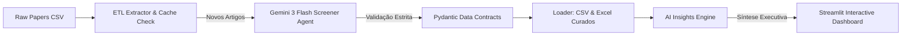

```markdown
# SciPaper Screener: Pipeline Autônomo de Triagem Científica e AI Insights

Pipeline de Engenharia de Dados e Inteligência Artificial de ponta a ponta para triagem automatizada, validação estruturada e geração de sínteses executivas de literatura científica aplicada a operações de tecnologia e atendimento ao cliente (Customer Support).

---

## 1. Problema de Negócio e Impacto

Times de Engenharia de IA e Produto gastam dezenas de horas analisando artigos científicos (arXiv, conferências) para identificar arquiteturas aplicáveis a problemas reais de operação — como redução de Tempo Médio de Atendimento (AHT), deflexão de chamados com RAG e mitigação de alucinações em produção.

O **SciPaper Screener** automatiza 100% do fluxo de leitura, filtragem e fichamento técnico usando o modelo **Gemini 3 Flash**, transformando dados brutos em planos de ação acionáveis para o roadmap de engenharia.

### Principais KPIs Obtidos (Benchmark Local)
* **Taxa de Aprovação Qualificada:** 66.7% (4/6 artigos altamente aderentes aprovados com score médio de **9.8/10**).
* **Redução de Tempo Operacional:** ~15 minutos economizados por artigo avaliado (~90 minutos economizados no lote de validação).
* **Idempotência e Economia de Tokens:** Mecanismo de cache incremental que evita reprocessamento e chamadas redundantes à API.

---

## 2. Arquitetura da Solução



### Estrutura Modular do Repositório

```text
scipaper-screener/
├── data/
│   ├── raw/                  # Base bruta de artigos (sample_papers.csv)
│   └── processed/            # Cache histórico, planilhas aprovadas e resumo executivo
├── src/
│   ├── config.py             # Gerenciamento centralizado de variáveis e caminhos
│   ├── etl/
│   │   ├── schemas.py        # Contratos de dados de entrada e saída (Pydantic)
│   │   ├── extractor.py      # Extração idempotente com verificação de cache
│   │   └── loader.py         # Persistência incremental e exportação (.csv / .xlsx)
│   ├── agents/
│   │   ├── prompts.py        # System instructions e templates com guardrails
│   │   └── screener_agent.py # Agente Gemini com retries exponenciais (Tenacity)
│   ├── analytics/
│   │   └── insights.py       # Cálculo de KPIs de negócio e geração de Resumo Executivo
│   └── app.py                # Dashboard interativo em Streamlit
├── main.py                   # Orquestrador CLI do pipeline completo
├── requirements.txt          # Dependências do ambiente
└── .env.example              # Exemplo de configuração de variáveis de ambiente

```

---

## 3. Stack Tecnológica

* **Linguagem:** Python 3.9+
* **IA & LLM:** Google GenAI SDK (`google-genai`) com modelo `gemini-3-flash-preview`
* **Validação e Contratos de Dados:** `Pydantic v2`
* **Resiliência e Retries:** `Tenacity` (Exponential Backoff)
* **Manipulação de Dados:** `Pandas` & `OpenPyXL`
* **Visualização e Produto:** `Streamlit`

---

## 4. Como Executar o Projeto

### 1. Clonar o repositório e preparar o ambiente

```bash
git clone [https://github.com/claramtenorio/scipaper-screener.git](https://github.com/claramtenorio/scipaper-screener.git)
cd scipaper-screener
python3 -m venv .venv
source .venv/bin/activate
pip install -r requirements.txt

```

### 2. Configurar variáveis de ambiente

Crie um arquivo `.env` na raiz do projeto com sua chave de API:

```env
GEMINI_API_KEY="sua_chave_aqui"
GEMINI_MODEL="gemini-3-flash-preview"

```

### 3. Executar o Pipeline Completo (ETL + Agente + Analytics)

```bash
python3 main.py

```

### 4. Iniciar o Dashboard Interativo

```bash
streamlit run src/app.py

```